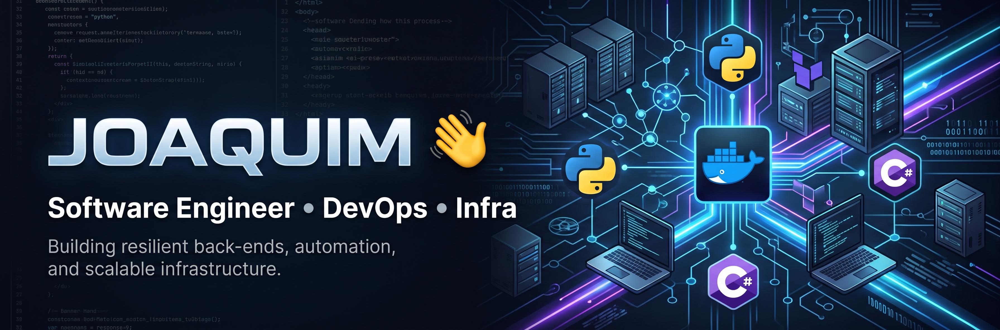

  

# Olá, eu sou o Joaquim 👋

Sou estudante de Desenvolvimento de Software Multiplataforma e atuo na intersecção entre engenharia de software, infraestrutura e redes. Tenho foco na construção de sistemas robustos, desde a arquitetura de APIs e automações até a administração e provisionamento de servidores.

- 🔭 Atualmente trabalhando com arquitetura de software, provisionamento em nuvem (GCP) via Terraform e integração de sistemas IoT.
- 🌱 Aprofundando conhecimentos em microsserviços, observabilidade e construção de pipelines de CI/CD.
- ⚙️ Administrando ativamente um ambiente Home Lab com Proxmox VE, storage ZFS e virtualização de serviços.

### 🚀 Projetos em Destaque

- **Lucía:** Plataforma RESTful e WebSocket para gestão administrativa construída com Python, FastAPI e PostgreSQL, utilizando Docker e pipelines automatizadas.
- **SGA-Notificações:** Sistema de integração e automação via webhooks conectando as filas do NovoSGA com serviços de mensageria.
- **Controlador IoT:** Micro-servidor embarcado em ESP32 rodando React (Vite) e SQLite, com gestão em tempo real via WebSockets para sistemas de irrigação.

### 🛠️ Linguagens e Tecnologias

  
  
  
  
  
  
  
  

